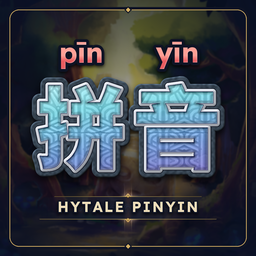

# HytalePinyin

Learn Chinese while you play: adds tone-marked pinyin to Hytale's official
Simplified Chinese item names, descriptions and menus.

Nothing is translated by hand. The Chinese and English texts are Hytale's own,
and the readings come from the [VividHanzi](https://github.com/ItsCogo-lab/VividHanzi)
pinyin pipeline (CC-CEDICT + pinyin-pro). Players download the mod from CurseForge.

## Layout

| Folder | What it is |
| --- | --- |
| `plugin/` | The Java server plugin (`src/`), its `manifest.json` and `build.sh`. Injects the pinyin texts, adds `/hanzi`, and in singleplayer installs the client patch (fonts and menu texts). |
| `glossary/` | Python pipeline that builds the pinyin texts from the game's files. See [glossary/README.md](glossary/README.md). |
| `vividhanzi-exporter/` | The VividHanzi script the glossary calls to get readings (goes in VividHanzi's `scripts/hytale/`). |
| `tools/` | Font tools: add the missing pinyin letters and small pinyin glyphs to the game's fonts, and bundle the client patch into the plugin. |
| `client-patch/` | Patched fonts and the standalone `install.ps1` installer. |
| `curseforge/` | CurseForge page text and changelog. |

## Building

The game's texts are not in this repository (they belong to Hypixel Studios),
so the generated files are rebuilt from your own Hytale install:

1. `glossary/build.py` (see its README) writes `glossary/out/`, including
   `out/lang/zh-CN*.lang` and `out/client/zh-CN/client.lang`.
2. Copy `glossary/out/lang/*.lang` to `plugin/resources/hytalepinyin/`.
3. `tools/bundle_client_patch.py GAME_SHARED_DIR glossary/out/client/zh-CN/client.lang plugin/resources/client-patch`
4. `plugin/build.sh JDK25_HOME PATH/TO/HytaleServer.jar` builds the JAR.

## License

MIT, see [LICENSE](LICENSE). Third-party data and fonts are listed in
[NOTICE.md](NOTICE.md); the fonts are under the SIL Open Font License
([client-patch/FONTS-LICENSE.txt](client-patch/FONTS-LICENSE.txt)).

HytalePinyin is a fan-made mod, not affiliated with Hypixel Studios.
